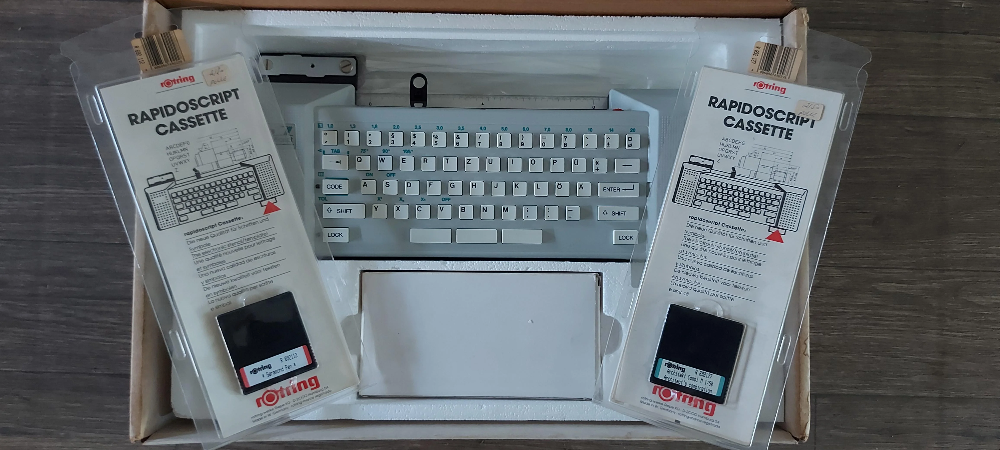

# bigraph_script
Rotring bigraph script 1R90 reverse engineering

The bigraph script is a scripting tool for technical designers, aiding in adding text according to DIN/ISO to drawings.
The device plots with an ink pen text and symbols. It features a keyboard and a ROM slot for Fonts.
The device is operated by a 68008 microprocessor with 8MHz, it has 8KB RAM and 64KB ROM. The steppers are driven by a pair of PBL3771 (Ericsson) and PBM3960 DACs. 
Additionally a TCA1560 and some HCT logic is on the board. The ROM is a 27C512, RAM 6264, there is a 4 bit DIP switch, a beeper, two hall sensors for homing.
The ROM slot is a 1.27mm pitch card edge connector, the card is about 53mm wide.

My device was dirty and malfunctioning due to hardened grease and lacks any ROM font cartridge, so I started disassembly and began to analyse the ROM with the help of AI.

This is a picture of a similar device including cartridges:

Additionally I got a bigraph scriber 1B90 for cheap, this device just had a shorted capacitor and now works.
I dumped the ROMs and found one to contain the fonts. The AI suggests that this font ROM is parsed correctly with the bigraph script 1R90 as well, so I will make a board with a 27C512 to test that.
